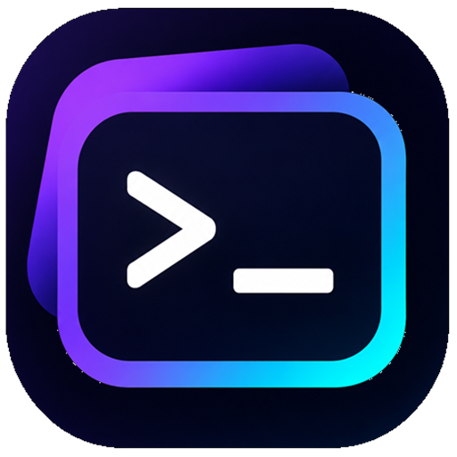

<p align="center">
  
</p>

<h1 align="center">NexTerm Desk</h1>

<p align="center">SSH, SFTP und Linux-Servermonitoring für Windows und Web.<br>Entwickelt von <a href="https://github.com/xjustanoah">xjustanoah</a>.</p>

<p align="center">
  <a href="https://github.com/xjustanoah/NexTerm/releases/download/v0.3.0/NexTerm-Desk-0.3.0-Setup.exe">Windows v0.3.0 herunterladen</a> ·
  <a href="https://github.com/xjustanoah/NexTerm/releases/tag/v0.3.0">Release Notes und Prüfsumme</a> ·
  <a href="SECURITY.md">Sicherheit melden</a>
</p>

NexTerm verbindet deine Serverprofile, Terminals, Dateien und Live-Messwerte in einem Workspace. Du kannst die Windows-App mit einem lokalen, verschlüsselten Tresor verwenden oder über die App und den Browser auf eine selbst betriebene NexTerm-Instanz zugreifen.

**Inhalt:** [Funktionen](#funktionen) · [Windows-App](#windows-app) · [Webserver starten](#webserver-starten) · [Konten und Workspaces](#konten-und-workspaces) · [Pelican](#pelican) · [Datenschutz und Backups](#datenschutz-und-backups) · [Updates und Grenzen](#updates-und-grenzen) · [Lizenz](#lizenz-und-urheberschaft)

## Funktionen

- **SSH-Terminal:** Anmeldung per Passwort oder privatem Schlüssel, optionale Schlüssel-Passphrase, Scrollback und automatische Größenanpassung.
- **SFTP:** Ordner durchsuchen, Dateien hochladen und herunterladen.
- **Serverprofile:** Beschreibungen, bis zu zwölf Tags, Suche und eine eigene Serverübersicht. Profile lassen sich über das Servermenü entfernen.
- **Linux-Monitoring:** CPU, RAM, Root-Dateisystem, Netzwerkdurchsatz und Systemlaufzeit; Aktualisierung alle drei Sekunden.
- **Maschineneinstellungen:** Beschreibung und Tags ändern sowie bei aktiver SSH-Verbindung einen Neustart anfordern. NexTerm führt dafür `reboot` mit den Rechten des angemeldeten SSH-Benutzers aus.
- **Workspaces und Themes:** Getrennte Serverlisten sowie Material Dark, Material White und Muxxle. Die Theme-Auswahl bleibt im jeweiligen Konto beziehungsweise lokalen Tresor gespeichert.
- **Webkonten:** Optionale OTP- und Passkey-Faktoren, Wiederherstellungscodes, Passwortänderung, optionaler E-Mail-Reset und Benutzerverwaltung für Admins.

Der Zielserver benötigt einen erreichbaren SSH-Dienst und für die Dateiübertragung SFTP-Unterstützung. Monitoring setzt ein Linux-Zielsystem mit `/proc`, `awk` und `df` voraus. Das integrierte Handbuch findest du oben rechts unter **Dokumentation**; im mobilen Browser erreichst du weitere Menüpunkte über das Drei-Punkte-Menü.

## Windows-App

1. Lade den [Windows-x64-Installer](https://github.com/xjustanoah/NexTerm/releases/download/v0.3.0/NexTerm-Desk-0.3.0-Setup.exe) herunter und installiere NexTerm Desk. Zusätzliches Node.js ist dafür nicht nötig.
2. Wähle beim Start **Lokaler Tresor** oder **Webserver**.
3. Lege einen Server an und verbinde dich mit deinem SSH-Passwort oder privaten Schlüssel.

| Betriebsart | Anmeldung | Speicherort |
| --- | --- | --- |
| Lokaler Tresor | Direkt öffnen, ohne separates NexTerm-Konto | Verschlüsselt im Windows-App-Profil dieses Geräts |
| Webserver | Mit dem Konto deiner NexTerm-Instanz | Verschlüsselt auf dieser Instanz; über Browser und Desktop-Webmodus zugänglich |

Der lokale Tresor verwendet AES-256-GCM. Sein zufälliger Schlüssel wird über Windows DPAPI geschützt. Im Webmodus merkt sich die Desktop-App die Serveradresse; SSH-Passwörter und private Schlüssel werden nicht in der Desktop-Konfiguration gespeichert. Entfernte Instanzen müssen unter einer HTTPS-Stammadresse erreichbar sein, etwa `https://ssh.example.com`.

Auf der [Release-Seite](https://github.com/xjustanoah/NexTerm/releases/tag/v0.3.0) findest du Release Notes und die SHA-256-Prüfsumme. Der Windows-Installer ist derzeit nicht mit einem Code-Signing-Zertifikat signiert.

### Windows-Installer selbst bauen

Mit den unten beschriebenen Quellcode-Voraussetzungen:

```powershell
npm ci
npm run dist:win
```

Der Installer wird unter `release/NexTerm-Desk-<Version>-Setup.exe` erzeugt.

## Webserver starten

Für Entwicklung und selbst betriebene Webserver benötigst du **Node.js 22.12 oder neuer** sowie npm.

```sh
git clone https://github.com/xjustanoah/NexTerm.git
cd NexTerm
npm ci
```

Für die **erste Registrierung** muss `NEXTERM_ADMIN_BOOTSTRAP_TOKEN` mit einem zufälligen Startcode aus mindestens 32 Zeichen gesetzt sein. Dieser Code wird beim Anlegen des ersten Admin-Kontos abgefragt. Beispiel für PowerShell:

```powershell
$env:NEXTERM_ADMIN_BOOTSTRAP_TOKEN = node -e "process.stdout.write(require('node:crypto').randomBytes(32).toString('hex'))"
$env:NEXTERM_ADMIN_BOOTSTRAP_TOKEN
```

Bewahre den angezeigten Code für die Erstregistrierung auf. Bei einer vorhandenen Installation ist er für weitere Registrierungen nicht erforderlich. Für einen dauerhaft betriebenen Dienst hinterlegst du benötigte Umgebungsvariablen in dessen Konfiguration.

**Entwicklung:**

```sh
npm run dev
```

Öffne die im Terminal angezeigte Vite-Adresse. Der Entwicklungsserver leitet API- und Terminal-Anfragen an den lokalen NexTerm-Dienst weiter.

**Produktionsbetrieb:**

```sh
npm run build
npm start
```

Der Webdienst läuft standardmäßig auf `http://127.0.0.1:4783`. Beide Startbefehle verwenden `start-server.cjs`, das den Datenschlüssel vorbereitet. Für öffentlichen Betrieb sind HTTPS und WebSocket-Weiterleitung erforderlich; siehe [Reverse Proxy und Anfragelimits](#reverse-proxy-und-anfragelimits).

### Konfiguration

| Variable | Bedeutung |
| --- | --- |
| `HOST` | Bind-Adresse, standardmäßig `127.0.0.1` |
| `PORT` | Port des Webdienstes, standardmäßig `4783` |
| `NEXTERM_DATA_DIR` | Datenverzeichnis, standardmäßig `~/.nexterm` |
| `NEXTERM_DATA_KEY` | Optionaler fester Datenschlüssel: genau 64 Hex-Zeichen, entsprechend 32 Byte |
| `NEXTERM_ADMIN_BOOTSTRAP_TOKEN` | Zufälliger Startcode mit mindestens 32 Zeichen für das erste Admin-Konto |
| `NEXTERM_ADMIN_USERNAME` | Benutzername für die Admin-Zuordnung bei der Migration älterer Konten |
| `TRUST_PROXY` | `1` ausschließlich hinter einem vertrauenswürdigen Reverse Proxy; Voraussetzungen siehe unten |

Ohne vorgegebenen `NEXTERM_DATA_KEY` erzeugt `start-server.cjs` beim ersten Start eine `.data-key` im Datenverzeichnis. Verwende anschließend immer denselben Schlüssel. Bestehende Klartextdateien werden beim Start verschlüsselt; fehlt der passende Schlüssel für verschlüsselte Daten, wird der Start abgebrochen.

## Konten und Workspaces

Webkonten benötigen Anzeigename, Benutzername, E-Mail-Adresse und ein Passwort mit mindestens zwölf Zeichen. Das erste Konto wird nach Bestätigung des Startcodes Admin. Unter **Einstellungen → Users** können Admins temporäre Passwörter für andere Konten setzen; betroffene Nutzer werden bei der nächsten Anmeldung zur Passwortänderung aufgefordert. Diese Benutzerverwaltung gibt es im lokalen Desktop-Tresor nicht.

Jedes Konto kann mehrere Workspaces mit eigenen Serverlisten verwenden. Browser und Desktop-Webmodus greifen beim selben Konto auf derselben Instanz auf dieselben Workspaces zu. Die Workspaces des lokalen Tresors bleiben auf dem jeweiligen Gerät. SSH-Sitzungen sind an die Anmeldung und den jeweiligen Workspace gebunden.

### OTP, Passkeys und Wiederherstellungscodes

OTP und Passkeys sind optionale zusätzliche Anmeldefaktoren für **Webkonten** und lassen sich über das Profil einrichten. Vor der Aktivierung muss bestätigt werden, dass die einmalig angezeigten Wiederherstellungscodes gesichert wurden. Jeder dieser Codes ist nur einmal verwendbar.

Passkeys benötigen einen sicheren Kontext: HTTPS oder für lokale Webentwicklung `localhost`. Bei Betrieb hinter einem Proxy muss die Anwendung das ursprüngliche HTTPS-Schema erkennen können. Optional lassen sich `NEXTERM_WEBAUTHN_RP_ID` und `NEXTERM_WEBAUTHN_ORIGIN` explizit setzen. Der lokale Desktop-Tresor öffnet ohne NexTerm-Anmeldung und bietet diese Konto-Anmeldefaktoren nicht an.

### Passwortänderung und E-Mail-Reset

Passwort und E-Mail-Adresse lassen sich in den Kontoeinstellungen ändern. E-Mail-Passwort-Resets sind standardmäßig deaktiviert. Für ihre Aktivierung werden folgende Einstellungen benötigt:

| Variable | Bedeutung |
| --- | --- |
| `NEXTERM_PASSWORD_RESET_ENABLED` | `1` aktiviert die Reset-Funktion, wenn die Pflichtangaben vorhanden sind |
| `NEXTERM_PUBLIC_URL` | Feste HTTPS-Stammadresse der Instanz, etwa `https://ssh.example.com` |
| `SMTP_HOST`, `SMTP_FROM` | SMTP-Server und Absenderadresse; erforderlich |
| `SMTP_PORT` | Standardmäßig `587` |
| `SMTP_SECURE` | `1` für implizites TLS |
| `SMTP_USER`, `SMTP_PASS` | Zugangsdaten, falls der SMTP-Server eine Anmeldung verlangt |

Reset-Links verwenden die konfigurierte öffentliche URL und laufen nach 30 Minuten ab. E-Mail-Adressen werden bei der Registrierung nicht verifiziert; richte SMTP und die feste öffentliche URL ein, bevor du E-Mail-Resets aktivierst.

## Pelican

Stelle im Git-Installer das Repository `https://github.com/xjustanoah/NexTerm.git`, den Branch `main` und die Option **Auto Update** ein. Verwende als Startup:

```sh
exec /usr/local/bin/node /home/container/pelican-start.cjs
```

Das Skript installiert Produktionsabhängigkeiten, verwaltet den Datenschlüssel unter `/home/container/.nexterm/.data-key` und startet den Dienst auf `0.0.0.0`. Der Standardport ist `8081`; `PORT` kann ihn überschreiben. Für eine leere Installation muss auch hier der Admin-Startcode gesetzt werden.

Mit `AUTO_UPDATE=1` und einem vorhandenen `.git`-Verzeichnis wird der Branch beim Start und anschließend alle 60 Sekunden auf neue Commits geprüft. Nach einem Update startet der Dienst neu; Web-Anmeldungen und aktive SSH-Verbindungen werden dadurch beendet. Der Server liefert das im Repository enthaltene `dist/` aus.

Für das öffentliche Repository werden keine Git-Zugangsdaten benötigt. Bei einem privaten Repository müssen `USERNAME` und `ACCESS_TOKEN` als geschützte Pelican-Variablen gesetzt sein. Das Skript gibt sie nur an Git weiter und entfernt sie aus der Umgebung von npm und NexTerm. Schreibe Zugangsdaten nicht direkt in den Startup-Befehl.

Der Pelican-Start setzt `TRUST_PROXY` standardmäßig auf `1`. Stelle deshalb sicher, dass die folgenden Proxy-Voraussetzungen erfüllt sind, oder setze die Variable ausdrücklich auf `0`.

### Reverse Proxy und Anfragelimits

- Terminiere HTTPS am Proxy und leite Host sowie ursprüngliches HTTPS-Schema korrekt weiter.
- Aktiviere die WebSocket-Weiterleitung für `/terminal`.
- Verwende `TRUST_PROXY=1` nur, wenn direkte Zugriffe auf den Node-Port gesperrt sind und der vertrauenswürdige Proxy eingehende `X-Forwarded-*`-Header überschreibt. Sonst lassen sich IP-basierte Limits mit gefälschten Headern umgehen.
- Begrenze zusätzlich Anfragen und Verbindungen am öffentlichen Proxy, besonders für `/api/auth`, `/api/admin`, WebSocket-Upgrades und lang laufende Übertragungen.

Vor JSON-Verarbeitung, Kontozugriffen und statischen Dateien gelten pro Serverprozess **600 HTTP-Anfragen pro Minute je IP** und ein gemeinsames Budget von **6.000 pro Minute**. IPv6-Adressen werden zu `/56`-Netzen zusammengefasst. Bei Erschöpfung liefert der Dienst HTTP `429` mit `Retry-After`. Unbekannte Seitenpfade sind zusätzlich auf 120 Anfragen pro Minute je erkannter IP begrenzt; für Kontoaktionen gelten strengere Limits.

Gleichzeitig sind höchstens **fünf SSH-Verbindungen pro Nutzer** und **32 pro Serverprozess** erlaubt. Laufende Verbindungsaufbauten zählen mit. Parallele Passwortprüfungen sind ebenfalls begrenzt. Diese Anwendungsgrenzen ersetzen keinen Verbindungsschutz am Proxy.

## Datenschutz und Backups

Kontodaten und Serverprofile werden mit AES-256-GCM verschlüsselt gespeichert. Kontopasswörter werden mit individuellem Salt und scrypt abgeleitet. SSH-Passwörter und private Schlüssel werden nicht dauerhaft in den Serverprofilen gespeichert. Beim ersten Kontakt zeigt NexTerm den SSH-Host-Fingerabdruck; gleiche ihn über einen vertrauenswürdigen Weg ab. Änderungen erfordern eine erneute Bestätigung.

Web-Anmeldesitzungen liegen im Arbeitsspeicher, laufen nach zwölf Stunden ab und enden beim Abmelden oder Dienstneustart. Der lokale Desktop-Tresor benötigt beim Öffnen keine separate NexTerm-Anmeldung.

Für eine konsistente Dateisicherung die App beziehungsweise den Dienst vorher beenden und **Daten samt zugehörigem Schlüssel** sichern:

| Betriebsart | Zu sichernde Daten |
| --- | --- |
| Webdienst | Vollständiges `NEXTERM_DATA_DIR` einschließlich `.data-key`; bei extern gesetztem `NEXTERM_DATA_KEY` auch dieses Geheimnis sicher aufbewahren |
| Pelican | Vollständiges Verzeichnis `/home/container/.nexterm` einschließlich `.data-key` |
| Windows-Tresor | Im App-Profil unter `%APPDATA%\nexterm-desk` den Ordner `vault` und die danebenliegende `vault-key.dpapi`; `launcher.json` enthält die gemerkte Webserver-Adresse |

Ohne passenden Datenschlüssel sind verschlüsselte Dateien nicht wiederherstellbar. Der Windows-Tresorschlüssel wird über DPAPI an die Windows-Anmeldung gebunden; es gibt derzeit keinen eingebauten portablen Tresor-Export für andere Windows-Konten.

Ältere **unverschlüsselte** `users.json`- und `hosts.json`-Dateien aus `~/.nexterm` werden beim ersten lokalen Öffnen übernommen, sofern die jeweilige Datei im Tresor noch fehlt. Bereits verschlüsselte Altdateien werden nicht automatisch importiert.

Sicherheitslücken bitte vertraulich gemäß [SECURITY.md](SECURITY.md) melden.

## Updates und Grenzen

- Die Windows-App hat derzeit keinen integrierten Updater. Neue Installer findest du unter [Releases](https://github.com/xjustanoah/NexTerm/releases).
- Pelican kann den konfigurierten Git-Branch automatisch aktualisieren; siehe oben.
- Teamfreigaben, SSH-Agent-Weiterleitung und Windows-/FreeBSD-Servermonitoring sind derzeit nicht enthalten.

## Lizenz und Urheberschaft

NexTerm Desk und die dazugehörigen eigenen Projektdateien wurden von **xjustanoah** erstellt. Der Quellcode steht unter einer eingeschränkten Source-Available-Lizenz. Du darfst das Projekt nicht als dein eigenes ausgeben oder verkaufen. Die Bedingungen für private Nutzung, Weitergabe und kommerzielle Nutzung stehen in [LICENSE](LICENSE). Drittanbieter-Abhängigkeiten unterliegen ihren jeweiligen Lizenzen.
